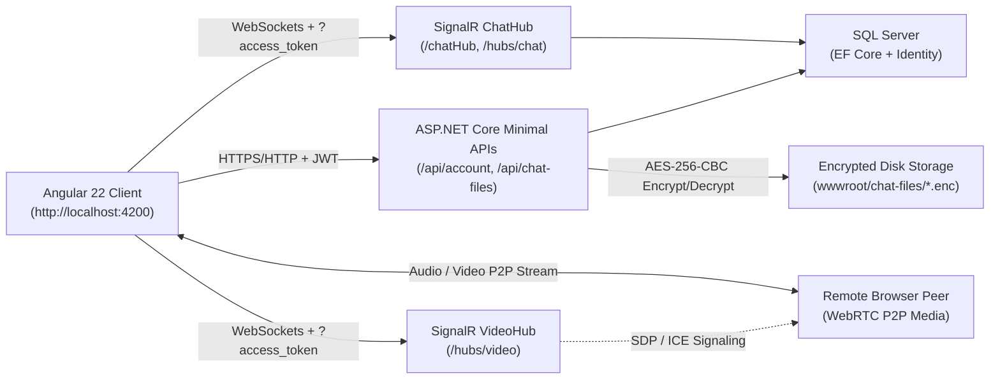

https://github.com/user-attachments/assets/d47339be-52c8-40fe-a269-3a10c0a980df

# 💬 Real-Time Chat Application

A full-stack, real-time 1-on-1 messaging, AES-256 encrypted file-sharing, and peer-to-peer WebRTC video/audio calling application built with **ASP.NET Core (.NET 10)**, **SignalR**, **Entity Framework Core**, **SQL Server**, **Angular 22**, **Tailwind CSS v4**, and **Angular Material**.

---

## 📑 Table of Contents

- [Project Overview](#-project-overview)
- [Core Idea & Architecture](#-core-idea--architecture)
- [Key Features](#-key-features)
- [Tools & Tech Stack](#-tools--tech-stack)
- [Project Structure](#-project-structure)
- [Getting Started (Installation & Setup)](#-getting-started-installation--setup)
- [How to Use](#-how-to-use)
- [API & SignalR Reference](#-api--signalr-reference)
- [Security & Production Notes](#-security--production-notes)

---

## 🎯 Project Overview

**Chat-Real-Time** provides an end-to-end modern messaging experience modeled after contemporary desktop chat clients. Authenticated users can discover registered contacts, track live online/offline presence and typing activity, exchange real-time text messages with read receipts and emoji reactions, securely share encrypted images and documents, and place peer-to-peer video or audio calls directly in the browser.

---

## 💡 Core Idea & Architecture

The project is built around three core architectural ideas:

### 1. Dual-Hub Real-Time Communication (`ChatHub` & `VideoHub`)
Instead of polling REST endpoints for updates, the backend exposes two JWT-authenticated **SignalR** hubs:
- **`ChatHub`** (`/chatHub` and `/hubs/chat`): Manages live user presence (`ConcurrentDictionary<string, OnlineUserDto>`), real-time 1-on-1 text message delivery, paginated history retrieval (`LoadMessages`), typing notifications, read receipt synchronization, and live emoji reactions (`ReactToMessage`).
- **`VideoHub`** (`/hubs/video`): Acts as a lightweight WebRTC signaling broker. It tracks active user connections by `UserIdentifier` (resolved via `ClaimsUserIdProvider`) and relays SDP offers, SDP answers, ICE candidates, camera/microphone media states, offline notifications, and hang-up events between peers. Actual audio/video media streams travel peer-to-peer over **WebRTC** (`RTCPeerConnection` with Google STUN servers).

### 2. Encrypted-at-Rest File Sharing
Chat attachments are never exposed as raw static files:
1. Both the Angular client (`ChatFileService`) and the .NET backend (`ChatFileValidator`) validate file extensions, block dangerous/executable types and double-extension spoofing (e.g., `payload.js.png`), and inspect file magic bytes/headers.
2. Validated files are encrypted with **AES-256-CBC (PKCS7 padding)** and a per-file random 16-byte IV using a SHA-256-derived key from `FileEncryption:Key`, then saved as `.enc` files inside `API/wwwroot/chat-files/{userA}_{userB}/`.
3. Direct static HTTP requests to `/chat-files/*` are explicitly blocked (`403 Forbidden` middleware in `Program.cs`).
4. Downloads and previews go through `GET /api/chat-files/{id}`, which enforces JWT authentication, checks that the caller is either the sender or the receiver, and streams decrypted bytes back on demand.

### 3. Unified Identity & Persistent Call Logs
- User accounts are managed with **ASP.NET Core Identity** (`AppUser` extending `IdentityUser` with `FullName` and `ProfileImage`) backed by **SQL Server** via **Entity Framework Core**.
- **JWT Bearer tokens** (HMAC-SHA256, 1-day expiration) authorize both Minimal API routes (`Authorization: Bearer <token>`) and SignalR WebSocket connections (`?access_token=<token>`).
- Completed, offline, or unanswered WebRTC calls automatically record structured `__CALL_LOG__:{...}` messages through `ChatHub`, rendering rich call-summary cards directly inside the conversation timeline.

### Architecture Flow



---

## ✨ Key Features

### Authentication & Profiles
- User registration with **Full Name**, **Username**, **Email**, **Password**, and required **Profile Picture** upload (stored under `API/wwwroot/uploads/`).
- JWT-based login with persistent session storage (`localStorage` + cookies) and route guards (`authGuard`, `loginGuard`).
- Three-pane responsive chat layout: Contact Sidebar, Active Chat Window, and Contact Profile Right Sidebar.

### Real-Time Messaging & Presence
- **Live Online/Offline Tracking**: Contacts sort automatically with online users at the top, plus real-time connection/disconnection updates and online toast notifications.
- **Instant Messaging & Unread Counts**: Real-time delivery with live unread message counters per contact, desktop browser notifications (`Notification` API), Material snackbar alerts, and sound alerts (`mixkit-correct-answer-tone-2870.wav`).
- **Typing Indicators**: Debounced typing broadcasts (`NotifyTyping`) shown in both the contact list and active chat header.
- **Read Receipts**: Automatic read marking when a conversation is open or loaded, displayed as double-check indicators (`Sent` vs `Read`).
- **Paginated Chat History**: Loads 10 messages per page with a **Load more** button and scroll-position preservation.

### Emojis & Message Reactions
- **Categorized Emoji Composer Picker**: 5 tabbed groups (*Smileys*, *Gestures*, *Hearts*, *Celebration*, *Food & Drink*) inserting directly at the cursor position.
- **Live Message Reactions**: Right-click (desktop) or press-and-hold for 450 ms (touch/pointer) on any message bubble to open the reaction popover (6 quick emojis + 18 extra emojis). Clicking a reaction toggles, replaces, or removes it in real time via `ReactToMessage` / `ReceiveReaction`, updating grouped reaction pills and unread reaction previews.

### Encrypted File & Image Attachments
- **Multiple Input Methods**: Dedicated photo picker button, paperclip file button, drag-and-drop overlay onto the chat window, and clipboard paste (`Ctrl+V`) support, with optional text captions.
- **Strict Validation (25 MB Max)**:
  - **Images**: `.jpg`, `.jpeg`, `.png`, `.gif`, `.webp`, `.bmp` (`.svg` blocked for XSS safety)
  - **Documents**: `.pdf`, `.doc`, `.docx`, `.ppt`, `.pptx`
  - **Archives**: `.zip`, `.rar`, `.7z`, `.tar`, `.gz`
  - **Text**: `.txt`, `.csv`, `.md`
  - Rejects scripts, executables (`.exe`, `.dll`, `.ps1`, `.sh`, `.js`, `.html`, macro-enabled Office files, etc.), double-extension filenames, and mismatched magic bytes.
- **Rich Previews**: Decrypted inline image rendering with full-screen lightbox viewer, browser-tab preview (`Open`) for PDF/text files, and authenticated `Download` with original filenames.

### WebRTC Video & Audio Calling
- **1-on-1 Calls**: Full-screen call dialog launched from the chat header with incoming call alerts and looping ringtone (`WhatsApp_-_Incoming_Call-646860-mobiles24.mp3`).
- **In-Call Controls**:
  - Toggle Camera (`Video` ↔ `Audio Only`) and Microphone (`Mute` / `Unmute`) with remote state indicators.
  - Mode switcher menu (`Audio & Video` / `Audio Only`).
  - Draggable Picture-in-Picture (PiP) local self-view.
  - Fullscreen toggle, live call duration timer (`HH:MM:SS`), and offline peer detection.
- **In-Chat Call History**: Automatically logs `Completed`, `Offline`, `Missed`, or `No answer` call cards in the chat thread.

---

## 🛠️ Tools & Tech Stack

### Backend (`API/`)
| Tool / Package | Version / Target | Purpose |
| :--- | :--- | :--- |
| **.NET / ASP.NET Core** | `net10.0` | Minimal APIs, hosting, static files, and middleware pipeline |
| **SignalR** | Built-in (`Microsoft.AspNetCore.SignalR`) | Real-time chat hub (`ChatHub`) and WebRTC signaling (`VideoHub`) |
| **Entity Framework Core & SQL Server** | `10.0.12` | ORM, migrations, and SQL Server database persistence |
| **ASP.NET Core Identity** | `10.0.12` | User management, password hashing, and `IdentityDbContext<AppUser>` |
| **JWT Bearer Authentication** | `10.0.12` | Stateless token auth for REST endpoints and SignalR query tokens |
| **Microsoft.AspNetCore.OpenApi** | `10.0.11` | OpenAPI specification generation in Development (`/openapi/v1.json`) |
| **System.Security.Cryptography** | Built-in | AES-256-CBC encryption/decryption for chat attachments |

### Frontend (`client/`)
| Tool / Package | Version | Purpose |
| :--- | :--- | :--- |
| **Angular** | `^22.1.0` (CLI `^22.1.8`) | Standalone components, Signals, reactive routing, and HTTP client |
| **TypeScript** | `~6.0.2` | Strongly typed application logic, models, and services |
| **@microsoft/signalr** | `^10.0.11` | SignalR JavaScript/TypeScript client with automatic reconnect |
| **Tailwind CSS** | `^4.3.3` (`@tailwindcss/postcss`) | Utility-first styling across auth pages, chat UI, and video call UI |
| **Angular Material & CDK** | `^22.2.0` | Dialogs (`MatDialog`), notifications (`MatSnackBar`), inputs, and icons |
| **RxJS** | `~7.8.0` | Reactive event streams for HTTP calls and WebRTC signaling subjects |
| **WebRTC & Web Audio APIs** | Browser Built-in | P2P media streaming (`RTCPeerConnection`), ringtones, and chimes |
| **Vitest & jsdom** | `^4.0.8` / `^28.0.0` | Unit testing framework and DOM environment (`npm test`) |
| **Prettier** | `^3.8.1` | Code formatting |

---

## 📁 Project Structure

```text
Chat-Real-Time/
├── Chat-Real-Time.sln
├── README.md
├── API/                                    # ASP.NET Core (.NET 10) Backend
│   ├── Program.cs                          # App configuration, DI, JWT, CORS, SignalR hubs, static guards
│   ├── API.csproj                          # NuGet dependencies & target framework (net10.0)
│   ├── appsettings.json                    # DB connection string, JWT config, FileEncryption key
│   ├── Properties/launchSettings.json      # http://localhost:5000 & https://localhost:7247 profiles
│   ├── Common/Response.cs                  # Generic API response wrapper (IsSuccess, Data, Error, Message)
│   ├── Data/AppDbcontext.cs                # EF Core IdentityDbContext (Messages, ChatAttachments, MessageReactions)
│   ├── DTOS/
│   │   ├── MessageRequestDto.cs
│   │   ├── MessageResponseDTO.cs
│   │   └── OnlineUserDto.cs
│   ├── Ednpoints/
│   │   ├── AccountEndpoint.cs              # /api/account/* Minimal APIs
│   │   └── ChatFileEndpoint.cs             # /api/chat-files/* encrypted upload & download APIs
│   ├── Entities/
│   │   ├── Appuser.cs                      # IdentityUser + FullName & ProfileImage
│   │   ├── ChatAttachment.cs               # Encrypted attachment metadata
│   │   ├── Login.cs                        # Login request DTO
│   │   ├── Meesage.cs                      # Message entity (Content, IsRead, Attachment, Reactions)
│   │   └── MessageReaction.cs              # Unique per-user/per-message emoji reaction
│   ├── Extenions/
│   │   └── ClaimsPrincipleExtenions.cs     # User ID & username claim resolution helpers
│   ├── Hubs/
│   │   ├── ChatHub.cs                      # Chat messaging, presence, typing, read receipts, reactions
│   │   └── VideoHub.cs                     # WebRTC signaling hub (Offer, Answer, ICE, MediaState, EndCall)
│   ├── Migrations/                         # EF Core migrations (Initial, MessageTable, AddChatAttachments, AddMessageReactions)
│   ├── Services/
│   │   ├── ChatFileService.cs              # AES-256-CBC encrypt/decrypt file service
│   │   ├── ChatFileValidator.cs            # Extension allowlist, dangerous extension blocklist & magic-byte checks
│   │   ├── ClaimsUserIdProvider.cs         # SignalR IUserIdProvider for Clients.User(...)
│   │   ├── FileUpload.cs                   # Profile picture upload helper (wwwroot/uploads)
│   │   └── TokenService.cs                 # HMAC-SHA256 JWT token generator
│   └── wwwroot/
│       ├── uploads/                        # User profile avatars
│       └── chat-files/                     # AES-256 encrypted attachments (blocked from direct static HTTP)
│
└── client/                                 # Angular 22 Frontend
    ├── angular.json                        # Angular build & asset config (maps src/assecc -> /assecc)
    ├── package.json                        # Frontend dependencies & scripts
    └── src/
        ├── assecc/                         # Notification chime (.wav) & incoming call ringtone (.mp3)
        └── app/
            ├── app.ts / app.html           # Root component managing VideoHub lifecycle & incoming call dialog
            ├── app.routes.ts               # Routes (/chat, /login, /register) with auth/login guards
            ├── chat/                       # Main 3-pane chat workspace shell
            ├── login/ & register/          # Auth pages
            ├── video-chat/                 # Full-screen WebRTC video/audio call modal & PiP controls
            ├── components/
            │   ├── chat-sidebar/           # Left contact list, search, online dots, unread counts, logout menu
            │   ├── chat-window/            # Active chat header, emoji picker, drag/drop/paste attachment composer
            │   ├── chat-box/               # Message bubbles, pagination, read ticks, reaction popover, lightbox, call logs
            │   └── chat-right-sildebar/    # Right contact profile summary panel
            ├── guards/                     # authGuard & loginGuard
            ├── models/                     # api-response.ts, message.ts, user.ts
            ├── services/
            │   ├── auth-service.ts         # Register, login, token/cookie persistence, user lookup
            │   ├── chat.ts                 # ChatHub SignalR state, notifications, sounds, reactions
            │   ├── chat-file.ts            # Client file validation, upload, Blob preview cache & download
            │   └── video-chat.ts           # VideoHub SignalR signaling, ICE buffering & ringtone audio
            └── utils/
                ├── call-log.ts             # __CALL_LOG__ serialization, parsing & duration formatting
                └── user-display.ts         # Avatar URL & initials helpers
```

---

## 🚀 Getting Started (Installation & Setup)

### Prerequisites
Make sure you have the following installed on your machine:
- **[.NET 10 SDK](https://dotnet.microsoft.com/download/dotnet/10.0)**
- **[SQL Server](https://www.microsoft.com/sql-server) / SQL Server LocalDB** (`(localdb)\MSSQLLocalDB` is configured by default)
- **[Node.js & npm](https://nodejs.org/)** (Angular 22; `package.json` specifies `npm@11.16.0`)
- **Entity Framework Core CLI** (to apply database migrations from the terminal):
  ```bash
  dotnet tool install --global dotnet-ef
  ```

### 1. Clone the Repository
```bash
git clone <your-repository-url>
cd Chat-Real-Time
```

### 2. Configure the Backend (`API/appsettings.json`)
Inspect `API/appsettings.json` and update the database connection string and keys if needed:
```json
{
  "ConnectionStrings": {
    "DefaultConnection": "Data Source=(localdb)\\MSSQLLocalDB;Initial Catalog=ChatApplciationUI;Integrated Security=True;Trust Server Certificate=True"
  },
  "Jwt": {
    "Key": "This is a secret key for JWT token generation",
    "Issuer": "ChatApp",
    "Audience": "ChatAppUsers"
  },
  "FileEncryption": {
    "Key": "ChatApp-Encrypted-Attachment-AES256-Key-2026"
  }
}
```
> **Note:** If you use a full SQL Server instance instead of LocalDB, replace `Data Source=(localdb)\MSSQLLocalDB` with your server name.

### 3. Apply Database Migrations
Navigate to the `API` directory and create/update the SQL Server database schema:
```bash
cd API
dotnet ef database update
```

### 4. Run the Backend API
From inside `API/`:
```bash
dotnet run
```
By default (`API/Properties/launchSettings.json`), the `http` profile runs on **`http://localhost:5000`**, which matches the URLs configured in the Angular client services (`AuthService`, `Chat`, `ChatFileService`, and `VideoChatService`).
*(To launch with HTTPS as well, run `dotnet run --launch-profile https`, which listens on `https://localhost:7247` and `http://localhost:5000`.)*

### 5. Install & Run the Angular Frontend
Open a second terminal, navigate to `client/`, install dependencies, and start the dev server:
```bash
cd client
npm install
npm start
```
The Angular app will be served at **`http://localhost:4200`**.

### Useful Build & Test Commands
- **Build Backend**: `cd API && dotnet build`
- **Build Frontend (Production)**: `cd client && npm run build`
- **Run Frontend Unit Tests (Vitest)**: `cd client && npm test`

---

## 📖 How to Use

1. **Create an Account & Sign In**
   - Open `http://localhost:4200` in your browser (unauthenticated users are redirected to `/login`).
   - Click **Register**, fill in your **Full Name**, **Username**, **Email**, and **Password**, and upload a **Profile Picture** (required).
   - Sign in on `/login`. When prompted, allow browser notifications so you receive message and reaction alerts while away from the tab.
   - *Tip:* To test real-time chat and video calls locally on one machine, open a second browser profile or Incognito/Private window and sign in with a second account.

2. **Browse Contacts & Manage Conversations**
   - The **left sidebar** displays all registered users, sorted with **Online** users (green dot) above **Offline** users (gray dot), along with unread message badges.
   - Use the **Search** box to filter contacts by full name or username.
   - Click any contact to open the conversation in the center panel and view their profile card in the right sidebar.
   - Click your own avatar/name in the top-left header to return to the chat home screen, or open the **⋮** menu to **Logout**.

3. **Chat, Use Emojis & React to Messages**
   - Type in the bottom message input and press **`Enter`** (or click **Send**).
   - Click the **Emoji (😊)** button to insert emojis from 5 categorized tabs.
   - **React to any message**: **Right-click** on a message bubble (or **press and hold** for ~0.5 seconds on touch devices) to open the reaction bar (`👍 ❤️ 😂 😮 😢 🙏` + `+` for more emojis). Click an existing reaction pill below a message to toggle your reaction.
   - Scroll to the top of a thread and click **Load more** to fetch older pages of messages (10 messages per page).

4. **Send Encrypted Files & Images**
   - Attach files using the **Camera** icon (images), the **Paperclip** icon (all supported file types up to 25 MB), **Drag & Drop** directly onto the chat window, or **Paste (`Ctrl+V`)** from your clipboard.
   - Preview the pending attachment, optionally add a caption, and click **Send**.
   - Click any received/sent image to open it in a full-screen **lightbox**; click **Open** on PDF or text files to view them in a new browser tab, or **Download** to save the decrypted file.

5. **Make Video & Audio Calls**
   - Click the **Video Camera** button in the top-right corner of an open chat header.
   - Grant browser **Camera** and **Microphone** permissions when prompted.
   - Use the bottom control bar during a call:
     - **Caret (`^`) Menu**: Switch between **Audio & Video** and **Audio Only**.
     - **Camera Button**: Turn local video on or off.
     - **Microphone Button**: Mute or unmute audio.
     - **Accept (Green) / End (Red)**: Answer incoming calls (which play a ringtone) or hang up.
   - Drag the **Picture-in-Picture** self-view window anywhere inside the video stage, or use the top-right **Fullscreen** button.
   - Once the call ends, a summary card (call type, status, duration, timestamp) is automatically logged in the chat thread.

---

## 📡 API & SignalR Reference

### REST Endpoints
| Method | Route | Auth | Description |
| :--- | :--- | :--- | :--- |
| `POST` | `/api/account/register` | Public | Multipart form registration (`fullname`, `email`, `password`, `username`, `profilePicture`) |
| `POST` | `/api/account/login` | Public | Authenticates email & password; returns JWT `token` and `user` |
| `GET` | `/api/account/me` | JWT | Returns the currently authenticated `AppUser` |
| `GET` | `/api/account/users` | JWT | Lists all other users with `IsOnline` status and `UnreadCount` |
| `POST` | `/api/chat-files/upload` | JWT | Validates, AES-256 encrypts, saves file (`receiverId`, `file`, optional `caption`), and emits `ReceiveMessage` |
| `GET` | `/api/chat-files/{id}?download=false` | JWT | Authorizes sender/receiver and streams decrypted file (`inline` preview or `download=true` attachment) |
| `GET` | `/openapi/v1.json` | Dev | OpenAPI specification (available in `Development` environment) |

### SignalR Hubs

#### `ChatHub` (`/chatHub` and `/hubs/chat`)
- **Client → Server Methods**:
  - `SendMessage(MessageRequestDto)` — Persists and delivers a 1-on-1 text message (or `__CALL_LOG__` entry).
  - `LoadMessages(recipientId, pageNumber = 1)` — Fetches a 10-message page and marks incoming unread messages as read.
  - `MarkAsRead(senderId)` — Marks all unread incoming messages from `senderId` as read.
  - `NotifyTyping(recipientUserName)` — Sends a typing notification to an online recipient.
  - `ReactToMessage(messageId, emoji)` — Adds, updates, or toggles off the user's reaction on a message.
- **Server → Client Events**:
  - `OnlineUsers`, `Notify`, `UserDisconnected`
  - `LoadMessages`, `ReceiveMessage`, `MessageRead`
  - `TypingNotification`, `ReceiveReaction`

#### `VideoHub` (`/hubs/video`)
- **Client → Server Methods**:
  - `SendOffer(reciverId, offer)`, `SendAnswer(reciverId, answer)`, `SendIceCandidate(reciverId, iceCandidate)`
  - `SendMediaState(reciverId, isVideoOn, isAudioOn)`, `EndCall(reciverId)`
- **Server → Client Events**:
  - `ReceiveOffer`, `ReceiveAnswer`, `ReceiveIceCandidate`
  - `ReceiveMediaState`, `UserOffline`, `CallEnded`

---

## 🔒 Security & Production Notes

Before deploying beyond local development:
- **Rotate Secrets**: Replace the development `Jwt:Key` and `FileEncryption:Key` in `API/appsettings.json` with strong environment variables or a secret manager (e.g., Azure Key Vault / `dotnet user-secrets`).
- **Configure Environment URLs**: Update the backend origin (`http://localhost:5000`) in `client/src/app/services/auth-service.ts`, `chat.ts`, `chat-file.ts`, and `video-chat.ts`, and update allowed CORS origins in `API/Program.cs` to match your production domain.
- **Enable HTTPS**: Uncomment `app.UseHttpsRedirection();` in `API/Program.cs` (required by browsers for WebRTC camera/microphone access on non-localhost origins).
- **Add TURN Servers**: `VideoChat` currently configures public Google STUN servers; add a TURN server in `ensurePeerConnection()` (`client/src/app/video-chat/video-chat.ts`) for reliable peer calls across strict corporate NATs and firewalls.


